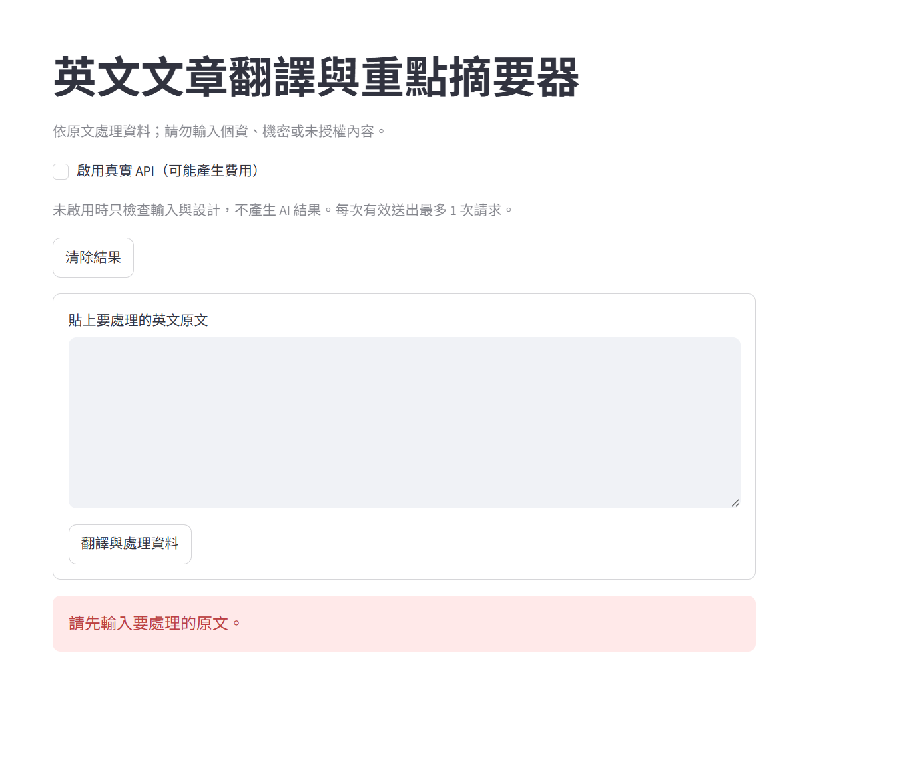
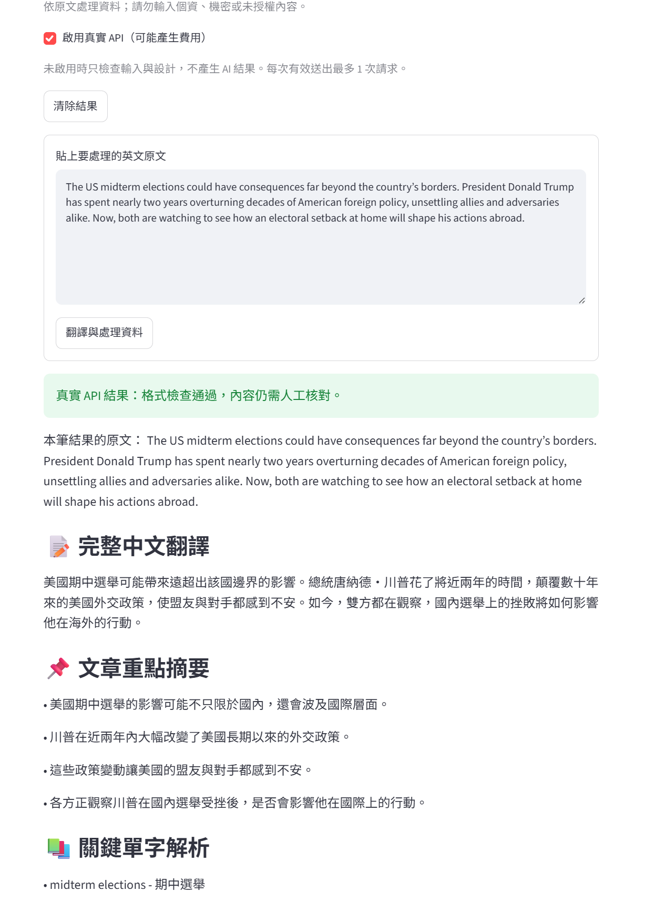

## 一、自己的問題與設計

| 項目 | 我的內容 |
|---|---|
| App 名稱／作者 | 英文文章翻譯與重點摘要器 / a113222023 |
| 目標使用者與情境 | 需要快速閱讀與理解英文長篇幅文章的學生或上班族。|
| 想完成的一個任務 | 將英文原文流暢翻譯成繁體中文，並自動擷取3到5個核心重點與進階關鍵單字解析。 |
| 輸入資料與範圍 | 英文文章原文，長度限制為 6000 字元以內。 |
| 資訊不足如何處理 | Prompt 已規定「只能嚴格依據原文內容進行翻譯與重點擷取，絕對不可自行捏造」，若原文極短，會直接依現況輸出或回報無對應重點。|
| 採用 starter 或自行實作 | 採用 starter。理由：以老師提供的架構為基礎，能更穩定地實作 Pydantic 結構化輸出並與 Streamlit 介面結合。 |
| 結構化輸出路線 | Pydantic。理由：與 OpenAI 的 beta.chat.completions.parse 完美整合，能透過 Python 類別強型別定義確保輸出格式，驗證直覺且嚴謹。 |
| 相較教師範例的個人設計 | 擴充了 ProjectResult，加入了 vocabulary (list[str]) 欄位；並自訂 FIELD_LABELS 搭配 Emoji（📝、📌、📚）讓介面更易讀。 |

## 二、輸出欄位契約

至少兩個有用途的欄位；可自行加列。

| 欄位名稱 | 型別／限制 | 用途 | 畫面標籤 | 如何查原文 |
|---|---|---|---|---|
| translation| str| 提供整篇文章的繁體中文翻譯 | 完整中文翻譯 |逐句比對原文，檢查意思是否精確傳達且無捏造。 |
| key_points | list[str]|列出原文的核心重點清單 | 文章重點摘要 | 確認清單項目是否確實從原文內容中提取，且無過度推論。 |

## 三、測試紀錄

| 項目 | 實際輸入／操作 | 實際輸出／錯誤 | 人工判讀與修正 | 證據類型 |
|---|---|---|---|---|
| 空白 | 點擊按鈕但未輸入內容 | 「請先輸入要處理的原文。」 | 成功擋下無效請求| |
| 過長 |貼上超過 6000 字的無意義字串 | 「請縮短到 6000 字元以內；不會默默截斷原文。」| 成功攔截，字數限制發揮作用| 離線／未測 |
| 正常資料 | 輸入："The US midterm elections could have consequences far beyond the country's borders..." | 輸出完整的中文翻譯，並列出美國期中選舉影響的重點，與擷取了consequences等單字。 | 逐欄查原文，翻譯準確無誤，重點與單字數量符合 3-5 個的要求。 ||
| 資訊不足 | 待填 | 待填 | 有無編造？ | 真實 API／未測 |
| 結果保存／再送出失敗 | 成功產出結果後，點擊「清除結果」按鈕 |畫面上的翻譯與 JSON 結果消失| 舊結果有成功清除，session_state 重置正常|實測 |
| 缺 key／服務失敗 | 隨意竄改 .env 內的 API Key 並送出 | 「本次未保存結果；請檢查金鑰...錯誤類型：AuthenticationError」 | 正確停止並顯示錯誤，沒有造成程式崩潰| 實測|
| Cloud 部署（必做） | 1151genai-app-development-xs9wprpiwcn3rn7degtfzt | 實際輸入／輸出、驗收日期2026/11/5、模型與請求數2 | 是否成功？逐欄查原文 成功| 雲端真實API／未測 |

真實 API 每筆補：測試日期、模型、完整虛構原文、實際 JSON／畫面結果、人工核對與實際請求數。
同一情境的修正前後用同一筆資料比較；不預設改 prompt 必然改善。不要用固定假回應填「真實 API」。
未測項目寫未測；請求失敗如實記錄，不捏造成功紀錄。真人瀏覽器／部署與程式模擬分開標示。
正常／資訊不足兩筆可直接在雲端完成，不必本機再重複呼叫；至少一筆須為雲端真實API成功。若追加測試，須另計請求數。

## 四、環境、交付與反思

Python／Streamlit／OpenAI SDK／python-dotenv 實際版本：待填。採 Pydantic 者另填其實際版本。
GitHub：[待填](https://github.com/a113222023/115_1_GenAI-App-Development.git)。啟動方式：streamlit run app.py。Streamlit Community Cloud部署網址（必填）：1151genai-app-development-xs9wprpiwcn3rn7degtfzt。
部署Repo／分支／入口、Cloud實際Python版本、驗收日期與結果：待填。老師觀看權限確認：待填。
部署為必做；未部署或未通過者如實記錄錯誤與待補驗項目，依老師公告期限完成，不以本機截圖代替。
本次實際請求數／追加測試數：待填。尚未完成的驗證：待填。
最有用的欄位、遇到的錯誤、已知限制與下一步：最有用的欄位：key_points 能大幅縮短閱讀長文的時間。

遇到的錯誤：初期使用了舊版或不正確的 SDK 方法呼叫結構化輸出，導致 TypeError，經修正為最新的 parse 方法後解決。

已知限制：目前單次處理上限為 6000 字元，超長篇論文無法一次處理。

下一步：考慮加入語言選項，讓使用者能指定將英文翻譯成日文或韓文，或加入下載成文字檔的功能。
