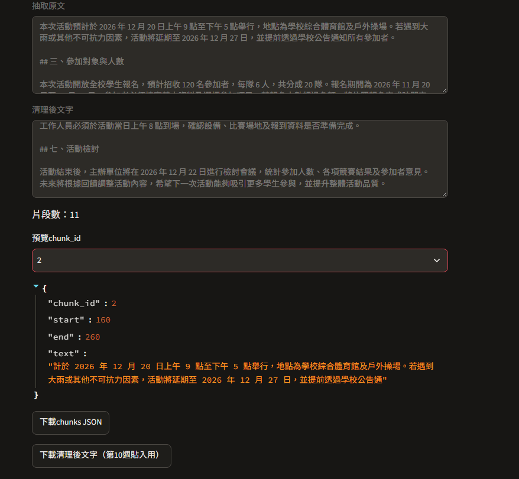
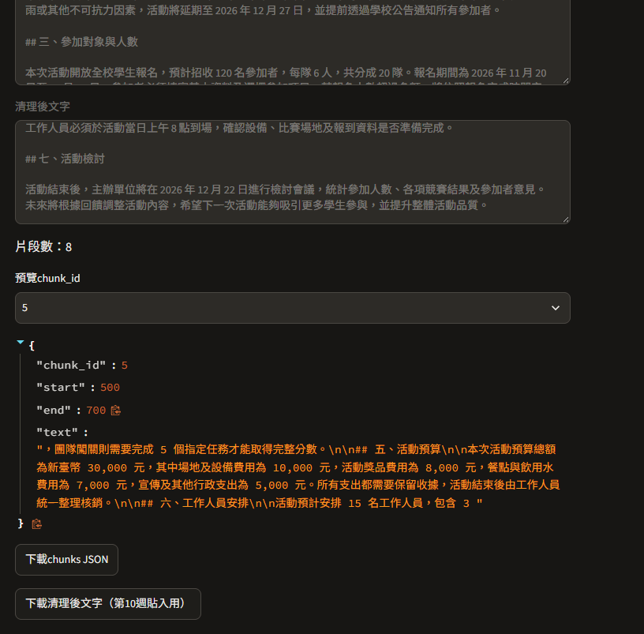

# 第 9 週回家作業：文件資料品質與片段測試

## A. 文件讀取與清理

本次使用自創的「2026 校園運動嘉年華活動企劃」作為測試文件，格式為 Markdown。文件包含七個段落，內容有活動日期、參加人數、預算及工作人員安排。

自我檢查：
1. 確認文件可以正常讀取。
2. 確認多餘的行內空白有被整理。
3. 確認原本的段落有保留。
4. 確認日期、數字及標點符號沒有遺失。

## B. 不同 overlap 比較

固定 chunk_size = 200，只改變 overlap。

| 項目 | A 組 | B 組 |
|---|---|---|
| chunk_size | 200 | 200 |
| overlap | 20 | 50 |
| 清理後字元數 |  |  |
| 片段數 |5 | 6|

### 實際邊界比較

A 組：
- chunk_id：2
- start:end：160
- 邊界附近原文：260

B 組：
- chunk_id：5
- start:end：500
- 邊界附近原文：700

比較心得：

兩組使用相同文件及 chunk_size，只有 overlap 不同。overlap 增加後，相鄰片段會保留較多重疊文字，有助於保留跨越切塊邊界的上下文，但也可能增加重複內容及片段數量。不能只用片段數量判斷哪一組比較好。

## C. 人工回查問題

問題：

本次活動預計在哪一天舉行？預計招收多少名參加者？

正確答案：

活動預計於 2026 年 12 月 20 日舉行，預計招收 120 名參加者。

### A 組支持答案的片段

- chunk_id：（填入實際 ID）
- 原文：（貼上包含活動日期及人數的實際 chunk 原文）
- 核對結果：日期及人數與原始文件相符。

### B 組支持答案的片段

- chunk_id：（填入實際 ID）
- 原文：（貼上包含活動日期及人數的實際 chunk 原文）
- 核對結果：日期及人數與原始文件相符。

這次是人工檢查 chunk 原文，不是使用向量搜尋。

## D. 錯誤與邊界測試

測試項目：設定 overlap 等於 chunk_size。

- 預期結果：系統應拒絕不合理的設定，避免切塊無法正常前進。
- 實際結果：（填入實際執行結果，例如系統顯示錯誤或成功阻止設定）
- 修正方式：將 overlap 調整為小於 chunk_size 的數值，例如 50。
- 重測結果：（填入重新執行後的結果）

## E. 結果反思

本次測試使用同一份活動企劃文件，比較不同 overlap 對文字切塊的影響。兩組都能透過原文片段人工找出活動日期及參加人數。增加 overlap 可以保留更多上下文，但也會增加重複文字。未來使用語意搜尋時，仍需要觀察片段內容是否足以支持問題答案。
](image-4.png)
](image-6.png)